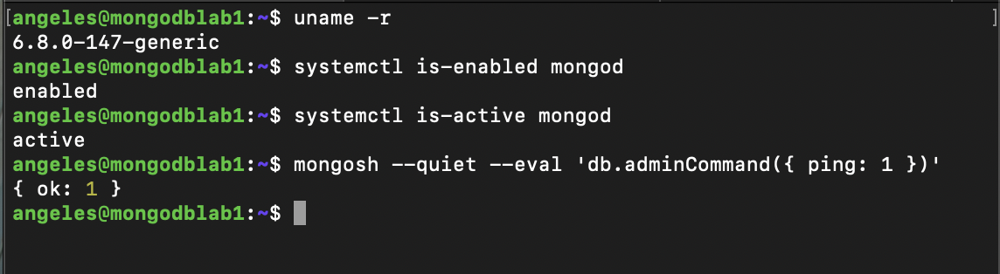
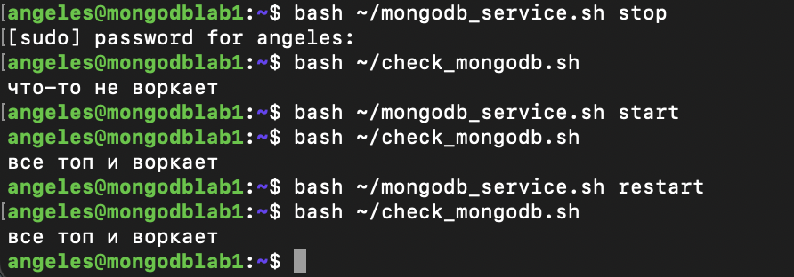
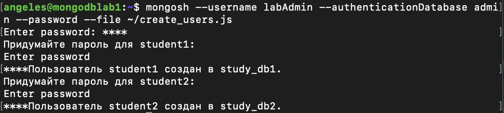
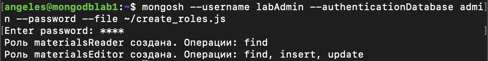
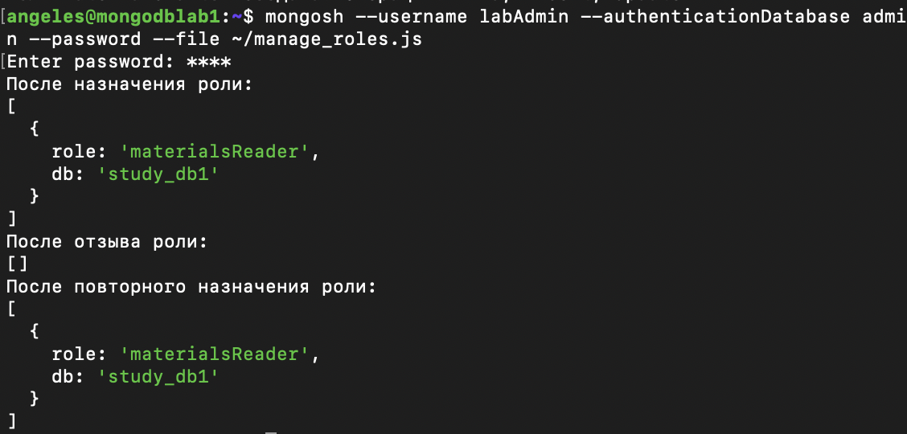
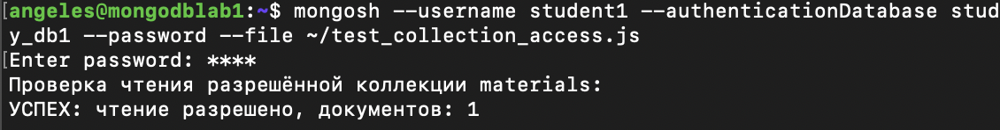
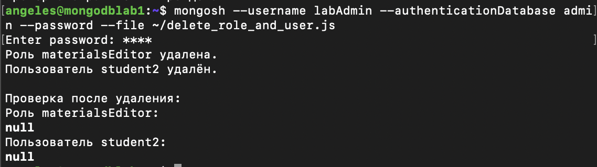
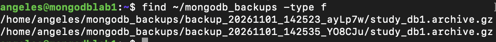
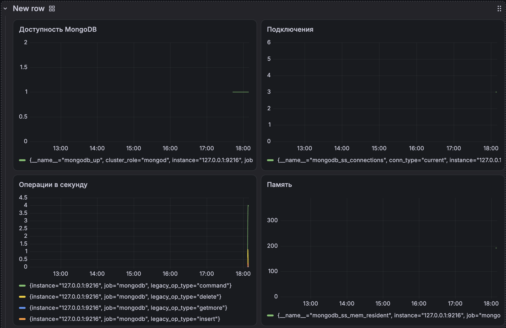
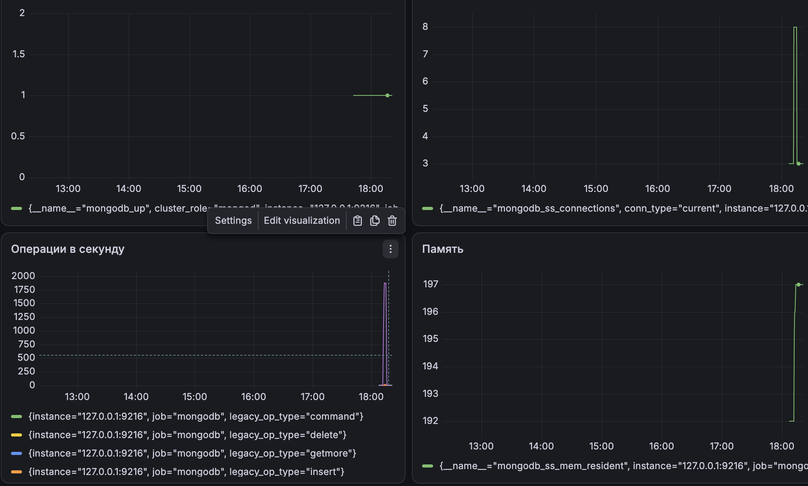

# Лабораторная работа №1. Эксплуатация MongoDB

## Цель работы

Развернуть MongoDB на виртуальной машине без Docker и
освоить её настройку, управление пользователями,
резервное копирование и мониторинг с помощью скриптов.

## Окружение

- Виртуальная машина: VirtualBox
- Операционная система: Ubuntu 24.04 Desktop
- Рабочий компьютер: MacBook
- Подключение к виртуальной машине: выполнил через SSH

## Ход работы

### 1. Базовая настройка

### 1.1. Подготовка хоста и установка MongoDB

Была создана виртуальная машина в VirtualBox и установлена
операционная система Ubuntu 24.04.4 LTS. Для удалённой работы
настроено подключение по SSH с MacBook.

Для установки MongoDB подготовлен скрипт
[`install_mongodb.sh`](setup/install_mongodb.sh).

Скрипт был создан на маке, скопирован на виртуальную машину
и запущен командой:

```bash
bash ~/install_mongodb.sh
```

### 1.2. Настройка и проверка автозапуска

Был включен автозапуск службы mongod. Выполним проверку автозапуска и доступности после перезагрузки.



### 1.3. Управление сервером

Для управления службой подготовлен скрипт
[`mongodb_service.sh`](setup/mongodb_service.sh). Он поддерживает
запуск, остановку, перезапуск и просмотр состояния MongoDB:

```bash
bash ~/mongodb_service.sh start
bash ~/mongodb_service.sh stop
bash ~/mongodb_service.sh restart
bash ~/mongodb_service.sh status
```

### 1.4. Проверка доступности сервера

Для проверки доступности подготовлен скрипт
[`check_mongodb.sh`](setup/check_mongodb.sh). Он отправляет серверу
команду `ping` через `mongosh` и сообщает результат.

При остановленной службе скрипт сообщил, что MongoDB недоступна.
После запуска и перезапуска сервер успешно ответил на проверку.



## 2. Управление ролевой моделью

### 2.1. Создание пользователей для учебных баз

Для работы с учебными данными подготовлен скрипт
[`create_users.js`](roles/create_users.js). Он создаёт две базы
данных study_db1 и study_db2 и пользователей.

В каждой базе создана коллекция materials с одним
документом. Пароли пользователей вводятся при выполнении
скрипта и не хранятся в репозитории.

Скрипт запускается от имени администратора MongoDB:

```bash
mongosh --username labAdmin --authenticationDatabase admin --password --file ~/create_users.js
```



### 2.2. Создание собственных ролей

Для создания ролей подготовлен скрипт
[`create_roles.js`](roles/create_roles.js). В базе `study_db1`
созданы две роли с разными наборами разрешённых операций.

Одна позволяет читать документы, вторая: читать, добавлять и изменять их.



### 2.3. Назначение и отзыв ролей

Для управления ролями пользователя подготовлен скрипт
[`manage_roles.js`](roles/manage_roles.js).

Пользователю была назначена роль,
затем роль была отозвана и назначена повторно. После каждого
действия скрипт выводит текущие роли пользователя.



### 2.4. Изменение разрешений существующей роли

Для изменения роли подготовлен скрипт
[`update_role.js`](roles/update_role.js).

### 2.5. Доступ к определённой коллекции

Для проверки ограниченного доступа были подготовлены скрипты
[`setup_access_test.js`](roles/setup_access_test.js) и
[`test_collection_access.js`](roles/test_collection_access.js).

Сначала от имени администратора была создана коллекция
study_db1.restricted. Затем от имени пользователя student1
с ролью materialsReader была выполнена проверка чтения коллекции

Таким образом, пользователь получил доступ к одной коллекции,
но не ко всей базе данных.



### 2.6. Удаление роли и пользователя

Для удаления подготовлен скрипт
[`delete_role_and_user.js`](roles/delete_role_and_user.js).

Были удалены роль materialsEditor из базы study_db1
и пользователь student2 из базы study_db2. Проверка после
удаления вернула null для роли и пользователя.



## 3. Резервное копирование и восстановление

### 3.1. Резервное копирование одной учебной базы

Для создания резервной копии одной базы данных подготовлен
скрипт [`backup_db.sh`](backup/backup_db.sh). 

Резервная копия сохраняется в сжатом архиве с расширением
`.archive.gz` в каталоге `~/mongodb_backups` на виртуальной
машине.

### 3.3. Хранение нескольких копий

Скрипт был запущен дважды для одной базы. Для каждого запуска
создаётся отдельная папка с датой, временем и уникальным
суффиксом. Поэтому новая резервная копия не перезаписывает
предыдущую.



### 3.2. Резервное копирование всех учебных баз

Для резервного копирования нескольких баз подготовлен скрипт
[`backup_all_dbs.sh`](backup/backup_all_dbs.sh). Имена баз передаются
скрипту как аргументы.

Скрипт создал отдельный сжатый архив для каждой базы в общей
папке резервной копии. 

### 3.4. Восстановление удалённой коллекции

Для восстановления подготовлен скрипт
[`restore_collection.sh`](backup/restore_collection.sh). Он принимает
путь к архиву, имя базы и имя коллекции и использует утилиту
`mongorestore`.

## 4. Мониторинг MongoDB

### 4.1. Выбор и настройка экспортера

Для получения метрик MongoDB был выбран Percona MongoDB
Exporter. Экспортер подключается к серверу MongoDB и
предоставляет метрики в формате Prometheus.

Для сбора диагностических показателей был включён параметр
`--collector.diagnosticdata`.


### 4.2. Выбор метрик

Для анализа состояния и производительности MongoDB были
выбраны следующие показатели:

| Показатель | Запрос Prometheus | Назначение |
| --- | --- | --- |
| Доступность MongoDB | `mongodb_up` | Проверка подключения экспортера к серверу |
| Текущие подключения | `mongodb_ss_connections{conn_type="current"}` | Контроль количества подключений |
| Операции в секунду | `rate(mongodb_ss_opcounters[1m])` | Оценка активности MongoDB по типам операций |
| Использование памяти | `mongodb_ss_mem_resident` | Контроль объёма резидентной памяти MongoDB в МБ |

Для сбора и хранения метрик установлен **Prometheus**. Он
получает данные от экспортера каждые 5 секунд.

### 4.3. Создание дашборда

Для визуализации метрик установлена **Grafana**. В качестве
источника данных подключён Prometheus.

В Grafana создан дашборд `MongoDB Lab` с панелями:

- доступность MongoDB
- количество текущих подключений
- количество операций в секунду
- использование памяти MongoDB.




### 4.4. Нагрузочное тестирование

Для создания нагрузки подготовлен скрипт
[`load_test.js`](monitoring/load_test.js). В течение трёх минут он
обновляет и читает документы в учебной коллекции
`study_db1.lab_load`.



Видно, что память, количество операций и подключений увеличилось, но досупность говорит о том, что MongoDB не переставала отвечать во время нагрузки.